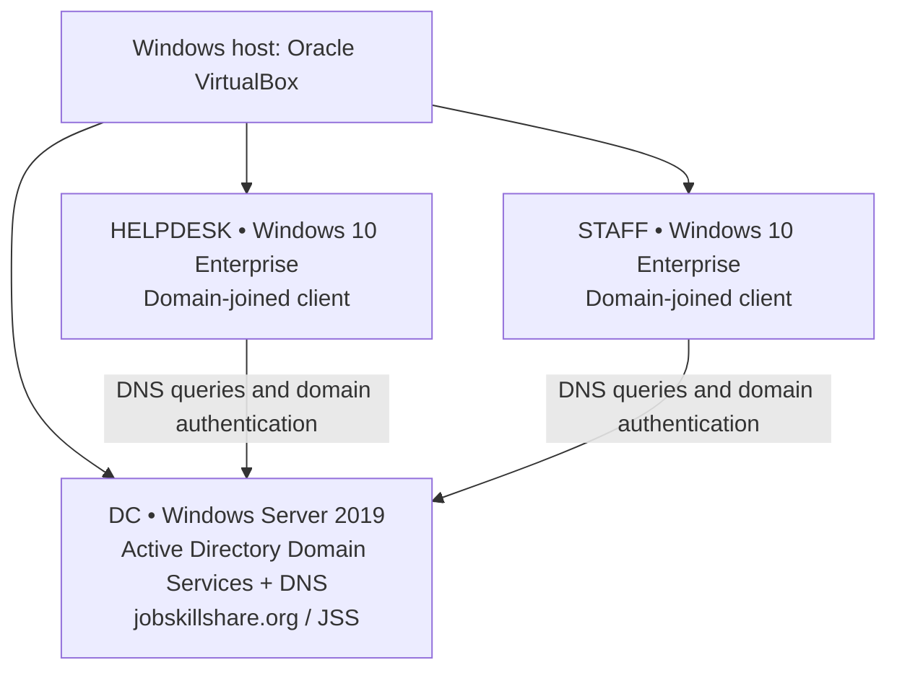

# Lab 01 — Logical Infrastructure Architecture

[Back to Lab 01](../labs/01-active-directory-environment/README.md) · [Troubleshooting runbook](../runbooks/active-directory-domain-join.md)

This **logical** diagram documents the systems and services verified in the lab. It is not a physical network topology or proof of VirtualBox adapter mode.

## Verified observations

| System | Function | Evidence |
|---|---|---|
| DC | Domain controller and DNS server | [Server role screenshot](../labs/01-active-directory-environment/screenshots/01-domain-controller.png) |
| HELPDESK | Domain-joined Windows client | [`jss\\helpdesk` identity](../labs/01-active-directory-environment/screenshots/03-helpdesk-domain-login.png) |
| STAFF | Domain-joined Windows client | [`jss\\staff` identity](../labs/01-active-directory-environment/screenshots/04-staff-domain-login.png) |
| Domain discovery | DC locator SRV lookup and `nltest` succeeded | [Discovery test](../labs/01-active-directory-environment/screenshots/07-dc-discovery-success.png) |

## Boundaries and follow-up

- The DC's `192.168.1.127` was a historical DHCP-leased address, not a guaranteed static IP.
- DNS over IPv6 on a client was suspected of interfering with AD queries. Disabling the IPv6 adapter binding was a **temporary workaround**, not the lasting design.
- The actual VirtualBox network adapter modes and full addressing plan were not preserved as verified evidence here. Do not infer a particular bridged, NAT, host-only, or internal topology from the diagram.
- Windows client cloning needs identity checks, and DC cloning must follow supported domain controller cloning procedures.
- Ordinary Staff users need workstation access, not interactive DC logon. Helpdesk's broad Domain Admin membership should be replaced with scoped delegation in a future lab.
